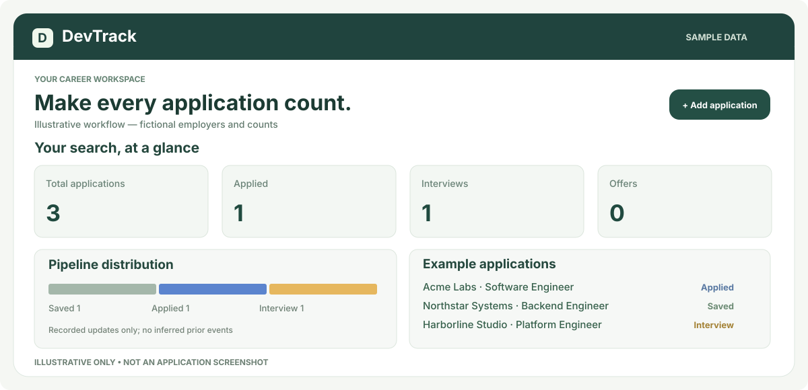
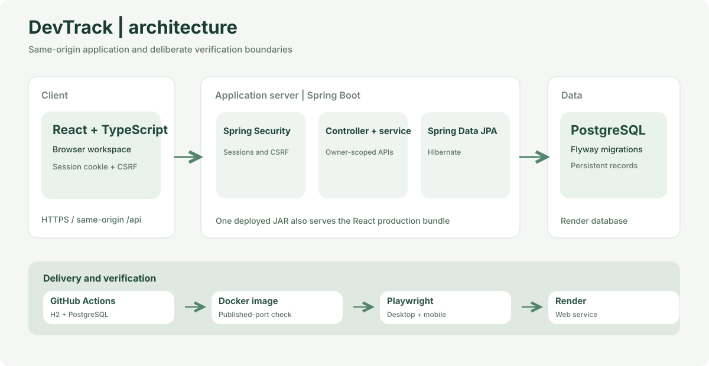

# DevTrack

[](https://github.com/bharath4980/devtrack/actions/workflows/ci.yml)
[](https://devtrack-3upd.onrender.com)

**DevTrack is a full-stack job-application workspace** built with **Java 21, Spring Boot, React, TypeScript, and PostgreSQL**. It helps users organize applications, track interviews and follow-ups, review recorded status changes, and understand job-search progress.

The engineering focus is secure multi-user data, honest analytics, practical third-party integration boundaries, automated browser testing, and a reproducible Docker deployment—not unnecessary infrastructure.

**[Live application](https://devtrack-3upd.onrender.com)** · **[Demo walkthrough](docs/demo.md)** · **[Architecture and decisions](docs/engineering.md)** · **[Operations and recovery](docs/operations.md)** · **[Production incident case study](docs/deployment-case-study.md)**

> Hosted on a Render Free web service. It can spin down when idle; waking the service may delay the first request. Use a unique password and sample application information if exploring the public site.

## Product overview



*Illustrative product overview—not a screenshot or production account data. The names and counts above are fictional. [See the safe demo walkthrough](docs/demo.md) for the current UI and an example exploration path.*

- **Track the pipeline:** switch between a searchable application list and a five-stage pipeline board (Saved, Applied, Interview, Offer, Rejected). Drag cards between stages or use the keyboard-accessible stage selector; load more items within each stage as needed. Changes use the same owner-scoped status endpoint and refresh the dashboard.
- **Keep an offline copy:** download an owner-scoped, UTF-8 CSV of all applications without changing or sharing stored records.
- **Act on next steps:** track overdue and due-today follow-ups, see the next seven days of upcoming follow-ups, and reschedule follow-up dates directly from the dashboard. Upcoming interviews show clear relative-date labels (UTC).
- **In-app reminders only:** reminders appear when you open the signed-in dashboard; they are not email, push, or background notifications.
- **Review real activity:** examine timestamped creation/status events and recent dashboard activity. Older applications with no recorded events show a clearly labeled **current-status snapshot**, not fabricated history.
- **Import carefully:** prefill editable company, title, and location from supported public Greenhouse, Lever, Ashby, SmartRecruiters, Workday, or BambooHR links. Unsupported providers fall back to manual entry.
- **Avoid repeat entries:** detect matching job URLs within your account (including common tracking-link variations) before saving; review the existing status or explicitly confirm Save anyway.
- **Learn from actual data:** view the six-month application trend, current pipeline distribution, and stage metrics; earlier unrecorded transitions can make some rates incomplete.

## Architecture



In production, the React app and Spring Boot API share one origin. Spring Security enforces sessions and CSRF checks; controller/service/repository operations scope application access to the authenticated account. Flyway manages PostgreSQL schema changes, and Hibernate validates the schema.

[Detailed request flow, migrations, and tradeoffs](docs/engineering.md) · [Authentication and ownership model](docs/authentication.md)

## Engineering decisions worth exploring

| Concern | Implementation | Why it matters |
| --- | --- | --- |
| Isolation | Session-authenticated ownership checks in repository and mutation paths | One account cannot access another account's applications |
| Validation | Backend validation, structured errors, frontend field feedback | Invalid input fails predictably |
| History | Transactional creation/status events; explicit legacy snapshots | No invented events or timestamps |
| External imports | Constrained Greenhouse/Lever/Ashby/SmartRecruiters handling and editable results | Avoids arbitrary URL fetching and unsafe scraping |
| Consistency | Flyway migrations, Hibernate validation, PostgreSQL tests | Keeps schema changes deliberate and testable |
| Delivery | Multi-stage non-root Docker runtime; GitHub Actions with H2, PostgreSQL and Playwright | Checks the built artifact and browser workflows before release |

## Verification at a glance

CI runs backend tests with H2 and PostgreSQL, builds the frontend and production Docker image, verifies the container through a published port, and runs desktop/mobile Playwright workflows on a **disposable test database**. Those browser tests cover account isolation, application workflows, analytics, and the legacy status-snapshot view.

The Render Free instance experienced startup/port-detection failures before PR #19. A measured JVM startup optimization and an improved container networking test were deployed successfully on October 18, 2026; the limits of that evidence are documented in the [deployment case study](docs/deployment-case-study.md).

## Stack

| Layer | Technologies |
| --- | --- |
| Backend | Java 21, Spring Boot 3, Spring Security, Spring Data JPA, Hibernate, Maven |
| Frontend | React, TypeScript, Vite, responsive CSS |
| Data | PostgreSQL, Flyway |
| Tests | JUnit, H2, PostgreSQL integration checks, Playwright desktop/mobile |
| Delivery | Docker multi-stage build, GitHub Actions, Render |

## Local setup

### Prerequisites

- Java 21
- Maven
- Node.js 22.12+
- Docker Desktop

### 1. Start PostgreSQL

From the repository root:

```sh
cp -n .env.example .env
docker compose up -d --wait
```

Check the database:

```sh
docker compose ps
```

To stop it:

```sh
docker compose down
```

The PostgreSQL data is stored in a Docker volume. Avoid `docker compose down -v` unless you intentionally want to delete the local database.

If you have data from the older pre-authentication version of DevTrack, see [authentication and ownership](docs/authentication.md#existing-local-databases) before starting the application.

### 2. Run the backend

On macOS, select Java 21 for the current terminal:

```sh
export JAVA_HOME=$(/usr/libexec/java_home -v 21)
```

Then:

```sh
cd backend
mvn spring-boot:run
```

The API runs at `http://localhost:8080`.

Health check:

```text
http://localhost:8080/api/health
```

Expected response:

```json
{"status":"UP"}
```

### 3. Run the frontend

In a second terminal:

```sh
cd frontend
npm ci
npm run dev
```

Open:

```text
http://127.0.0.1:5173
```

Vite proxies local `/api` requests to Spring Boot on port 8080.

## Verification

### Backend

```sh
cd backend
mvn clean test
```

### Frontend

```sh
cd frontend
npm run build
```

GitHub Actions verifies the project in two layers:

1. Runs the backend suite with H2.
2. Re-runs backend tests against a disposable PostgreSQL database, builds the frontend and production Docker image, starts that image, then executes Playwright browser workflows on desktop and mobile Chromium.

The browser suite covers registration/login, CRUD, interview tracking, filters, pagination, validation feedback, persistence after reload, account isolation, expired sessions, and legacy history snapshots. A passing test run is not a substitute for inspecting existing authenticated production records.

To run the isolated production browser checks locally:

```sh
docker compose -p devtrack-e2e -f compose.test.yaml up --build -d
cd frontend
npm ci
npx playwright install chromium
npm run test:e2e
cd ..
docker compose -p devtrack-e2e -f compose.test.yaml down
```

The test environment uses port 8081 and a disposable PostgreSQL database. Do not point these tests at the live demo or your normal development database.

## Production deployment

The root `Dockerfile` uses a multi-stage build:

1. Build the React frontend with Node.js.
2. Build the Spring Boot application with Maven and Java 21.
3. Copy the frontend production bundle into Spring Boot's static resources.
4. Run the final application as a non-root user from a Java 21 JRE image.

The deployed service uses:

- `DATABASE_URL`
- `DATABASE_USER`
- `POSTGRES_PASSWORD`
- `SESSION_COOKIE_SECURE=true`
- `PORT=8080`

Secrets stay in the hosting environment and are not committed to the repository. The application supports graceful shutdown and exposes anonymous, non-detailed `/api/health` readiness checks (including database health). Render currently uses default port checks because its **HTTP health-check path is not configured**; see the [operations and recovery runbook](docs/operations.md) for validation and a separately approved path change.

## Design tradeoffs

DevTrack deliberately stays a single-service application instead of adding distributed infrastructure that the current workload does not need.

Current tradeoffs:

- Sessions and authentication throttle counters are in memory and reset on restart.
- Password reset and email verification are not implemented.
- Upcoming interviews use day-level dates and UTC; reminders and time-of-day scheduling are out of scope.
- Search uses relational substring matching instead of a dedicated full-text search service.
- Concurrent edits use last-write-wins.
- Job posting autofill supports public Greenhouse, Lever, Ashby, SmartRecruiters, Workday, and BambooHR links; other job boards require manual entry.

For the detailed reasoning behind these choices, see [engineering notes](docs/engineering.md). The [safe demo walkthrough](docs/demo.md) uses only illustrative or disposable data, and the [deployment case study](docs/deployment-case-study.md) distinguishes confirmed evidence from outstanding checks.
